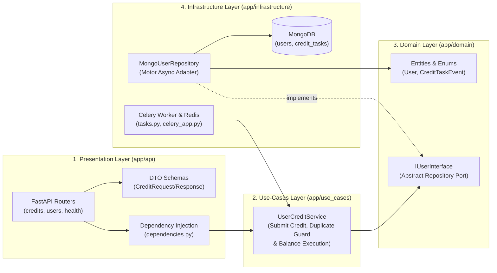

# Technical Design Document: Async Credit Processing Service

**Author:** Mike Wallace  
**Stack:** Python 3.11+, FastAPI, Celery, Redis, MongoDB (Motor), React (Vite/Nginx), Docker Compose

---

## 1. Summary & Overview of Decisions
This async credit processing service is organized using Clean Architecture principals to decouple layers of the application. 
It consists of an API layer using FastAPI with pydantic models that validate incoming requests and structure responses,
an Application Services layer in the use-cases directory to manage interoperability between infrastructure pieces and the core domain,
a domain layer for core business logic and a repository layer to connect to DynamoDB. 

Before decision points, I'll note that the vast majority of code and portions of this document were written by Gemini 4 Argon and
Gemini 3.8 Flash. I used planning mode to design the updates and worked through multiple plan iterations before applying the changes.

**Additional Decision points:**
- I updated the API and data model by incorporating a Credit Task database model. This model stores the credit amount, user,
and status instead of keeping status on the user record. This allows for multiple credits to be submitted (potentially from different actors) 
at the same time for a single user. 
- FastAPI and MongoDB's AsyncIOMotorClient use asyncio natively, but celery workers are naturally synchronous. To allow the same async use-case to be applied both within the core app and celery tasks,
a asyncio event loop singleton is made accessible by tasks.
- To prevent crediting a user account erroneously through double-clicking, I added a guard that looks for other tasks submitted in the last 5 minutes with the same credit value.
If some are found, they are marked as duplicates and fail. Other in-flight celery events are also identified and revoked if they meet the same qualifications.
- I chose Redis as a broker because the task data is small and Redis is faster than RabbitMQ. If the tasks required sending larger data payloads, I'd choose RabbitMQ
- There is a front-end added for easy visibility and testing. I did not architect that code since it was not a requirement and do not condone its structure.
- I decided to only promote spinning the app up using `docker compose` so the backend, Celery, Redis and MongoDB would all spin up in their own containers.

### Application Layering
To ensure maintainability, testability, and strict separation of concerns, the backend is organized into four concentric layers following **Clean Architecture** and the **Dependency Inversion Principle (DIP)**:

1. **Domain Layer (`app/domain`)**: Defines core entities (`User`, `CreditTaskEvent`), strict lifecycle enums (`UserStatus`, `TaskStatus`), and the abstract persistence port (`IUserInterface`).
2. **Use-Cases Layer (`app/use_cases`)**: Encapsulates application business rules inside a unified **`UserCreditService`**:
   - **Ingestion & Queries: Orchestrates credit submission and state queries via an injected `IUserInterface`.
   - **Worker Execution: Invoked by the Celery worker to enforce the 5-minute duplicate credit guard, revoke queued duplicate tasks, and apply valid balance updates.
3. **Infrastructure Layer (`app/infrastructure`)**: Implements concrete adapters:
   - **`MongoUserRepository`**: Implements `IUserInterface` using Motor (`AsyncIOMotorClient`), encapsulating all database connection management (`get_async_database`) and atomic state guards.
   - **Celery & Redis (`celery_app.py`, `tasks.py`)**: Configures Redis as both message broker (`db 0`) and result backend (`db 1`), with exponential backoff retries (`max_retries=3`).
4. **Presentation Layer (`app/api`)**: FastAPI routers (`credits.py`, `users.py`, `health.py`), app factory (`app.py`), and DTO schemas (`schemas.py`) with bidirectional domain converters (`to_event()`, `from_event()`, `from_user()`).

---

## 2. End-to-End Component Interaction Flow

1. **Request Ingestion (`POST /credits`)**:
   - FastAPI validates `CreditRequest` (`user_id` non-empty, `amount > 0`; rejects invalid payloads with `422 Unprocessable Entity`).
   - `UserCreditService.submit_credit()` converts the request into a `CreditTaskEvent(status="processing")` with a generated UUID `task_id` and persists it to the `credit_tasks` collection via `MongoUserRepository`.
   - `UserCreditService` upserts the user document in the `users` collection with `status="processing"`.
   - `UserCreditService` dispatches `process_credit.apply_async(args=[task_id], task_id=task_id)` to Redis and returns `202 Accepted`.
2. **Asynchronous Worker Execution (`process_credit`)**:
   - The Celery worker consumes `task_id` from Redis and invokes `UserCreditService.execute_credit_task(task_id)`.
   - **5-Minute Duplicate Validation**: The service queries `credit_tasks` for any active (`processing`) or completed (`processed`) task for the same `(user_id, amount)` within the last 5 minutes.
   - **Pre-Emptive Queue Revocation**: If newer duplicate tasks (`created_at > current.created_at`) are sitting in the queue, the worker marks them `revoked_duplicate` in MongoDB and broadcasts `celery_app.control.revoke(task_ids)` to discard them from the broker queue.
   - **Duplicate Rejection vs. Balance Update**:
     - If an earlier or already-processed task exists within the 5-minute window, the current task is marked `failed_duplicate` and the user's status is reconciled back to `processed` (if no other tasks are in flight).
     - Otherwise, the task atomically transitions from `processing` $\rightarrow$ `processed`, and MongoDB atomically increments the user's balance (`$inc: {"balance": amount}`) and sets `users.status = "processed"`.

---

## 3. Testing Strategy

The test suite (`backend/tests/`) follows the testing pyramid across all five architectural layers, executable via `docker compose run --rm backend pytest tests/ -v`:

| Layer | Suite | Coverage Focus |
| :--- | :--- | :--- |
| **Domain** | `test_domain.py` | Entity defaults, UTC timezone normalization, exclusion of invalid states, DTO-to-entity converters (`to_event`, `from_event`, `from_user`), and abstract port enforcement. |
| **Repository** | `test_repository.py` | Atomic `$inc` updates, creation guard rejecting non-`processing` tasks, optimistic concurrency filter preventing terminal-state overwrites, and 5-minute query filters. |
| **Use-Cases** | `test_use_cases.py` | `UserCreditService` ingestion (`submit_credit`) and worker execution (`execute_credit_task`): happy path, 5-min duplicate rejection, burst queue revocation, user status reconciliation, and concurrent revoke abort. |
| **Worker** | `test_worker_tasks.py` | Persistent event loop reuse across invocations, `celery_app.control.revoke` integration, and task execution wiring. |
| **API** | `test_credits.py` | FastAPI `TestClient` tests with DI overrides for `POST /credits` (`202` & `422`), `GET /users/{id}` (`200` & `404`), `GET /credits/{id}`, and `GET /health`. |

---

## 5. Frontend Console & Additional Enhancements

- **Interactive React Console (`frontend/`)**: Built with React, Vite, and served via Nginx on port `3000`. Allows reviewers to submit credit requests, view live task IDs, and automatically poll `GET /users/{user_id}` every second to watch the status transition from `processing` $\rightarrow$ `processed` and see live balance updates.
- **Database Indexing & Lifespan Management**: On startup, FastAPI's `lifespan` hook automatically provisions unique indexes on `users(user_id)` and `credit_tasks(task_id)`, plus a compound index on `credit_tasks(user_id, amount, created_at)` for $O(\log N)$ 5-minute window lookups.
- **Future Production Roadmap**:
  1. **API-Edge Idempotency Keys**: Accept an `Idempotency-Key` header in `POST /credits` stored in Redis with a TTL to short-circuit network retries before hitting MongoDB.
  2. **Transactional Outbox Pattern**: Write the `CreditTaskEvent` and `users` status update inside a MongoDB multi-document transaction, using Change Streams to publish to Redis for guaranteed at-least-once delivery even if Redis is momentarily unreachable.
