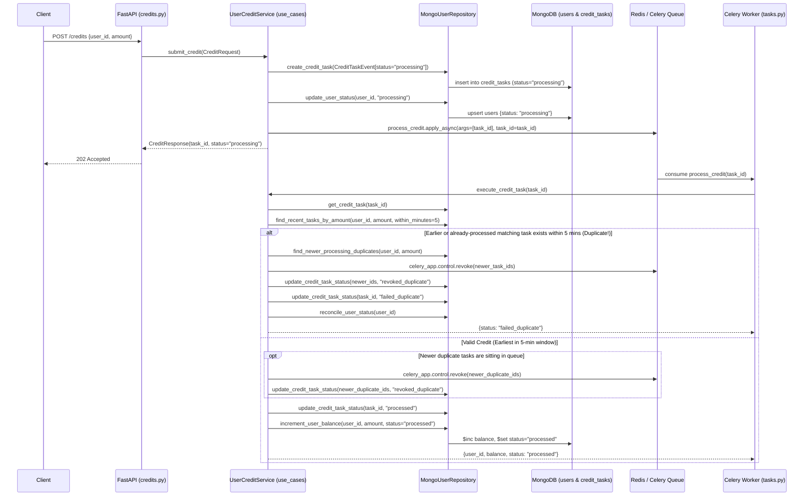

# Async Credit Processing Architecture & Design

## Overview

The Async Credit Processing Service implements a **Clean Architecture (Ports & Adapters)** pattern using **FastAPI**, **Celery**, **Redis**, and **MongoDB** (`Motor`).

### Architectural Layers

1. **Presentation Layer (`app/api`)**:
   - Exposes REST endpoints (`POST /credits`, `GET /credits/{task_id}`, `GET /users/{user_id}`, `GET /health`).
   - Uses FastAPI dependency injection (`dependencies.py`) to wire `MongoUserRepository` into `UserCreditService`.
2. **Use-Cases Layer (`app/use_cases`)**:
   - **`UserCreditService`**: Unified application service managing the complete credit lifecycle:
     - **`submit_credit()`** (API Path): Creates a `CreditTaskEvent` in MongoDB (`status="processing"`), sets the user's status to `"processing"`, and dispatches the Celery task with a unified UUID `task_id`.
     - **`execute_credit_task()`** (Worker Path): Executed by the Celery worker. Validates against duplicate credit amounts for the same user within a **5-minute rolling window**, revokes newer duplicate tasks still in the Celery queue, and atomically applies valid credits.
3. **Domain Layer (`app/domain`)**:
   - Defines core business entities (`User`, `CreditTaskEvent`, `UserStatus`, `TaskStatus`) and the abstract repository port (`IUserInterface`).
4. **Infrastructure Layer (`app/infrastructure`)**:
   - **`MongoUserRepository` (`repositories/user_repository.py`)**: Concrete MongoDB implementation of `IUserInterface` managing `users` and `credit_tasks` collections with optimistic concurrency guards on terminal task statuses.
   - **Celery Worker (`tasks.py`, `celery_app.py`)**: Consumes queued credit task IDs and executes `UserCreditService.execute_credit_task()` on a persistent per-worker-process `asyncio` event loop.

---

## End-to-End Sequence Diagram

---

## Key Design Decisions & Safeguards

### 1. 5-Minute Duplicate Credit Protection & Queue Revocation
- When `UserCreditService.execute_credit_task()` executes for `task_id`, it queries `credit_tasks` for any other task with the same `(user_id, amount)` created within the last 5 minutes that is currently in `processing` or `processed`.
- **Self-Match & Race Prevention**: The current `task_id` is excluded. A task only fails as `failed_duplicate` if another matching task was already `processed` or created **earlier** (`created_at <= current_task.created_at`).
- **Pre-Emptive Queue Revocation**: Any matching task created **later** (`created_at > current_task.created_at`) that is still in `status="processing"` is immediately transitioned to `revoked_duplicate` in MongoDB and revoked from the Celery broker via `celery_app.control.revoke(task_ids, terminate=False)`.
- **Infinite Lockout Prevention**: Rejected duplicate tasks (`failed_duplicate` / `revoked_duplicate`) are excluded from future 5-minute window queries so a rejected retry does not reset the 5-minute cooldown timer.

### 2. Repository Terminal-State Guards
- **Creation Guard**: `MongoUserRepository.create_credit_task()` validates that new task records can only be created with `status="processing"`.
- **Optimistic Concurrency Guard**: `MongoUserRepository.update_credit_task_status()` filters on `{"task_id": task_id, "status": "processing"}` in `find_one_and_update`. Once a task transitions to `revoked_duplicate`, `failed_duplicate`, or `processed`, it cannot be overwritten by an in-flight worker race condition.

### 3. Scaling Implications of a Dedicated Worker Event Loop in Celery
- **Connection Reuse**: Each Celery `prefork` child process maintains a single persistent `asyncio` event loop (`_get_worker_loop()`), keeping Motor's `AsyncIOMotorClient` and its MongoDB TCP connection pool warm across tasks.
- **Fork-Safety**: `get_async_database()` initializes lazily inside each forked worker process rather than at master import time.
- **Unified Codebase**: Enables sharing a single `async` `IUserInterface` and `MongoUserRepository` across both FastAPI and Celery without duplicating synchronous/asynchronous repository implementations.
